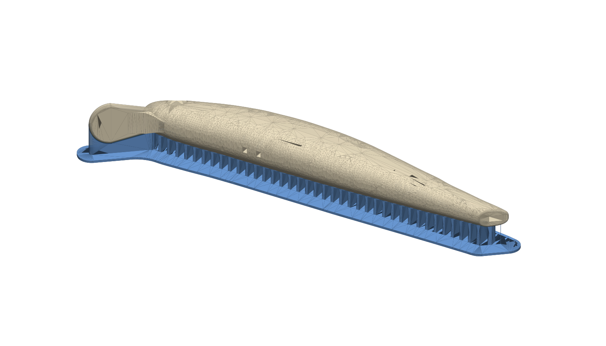
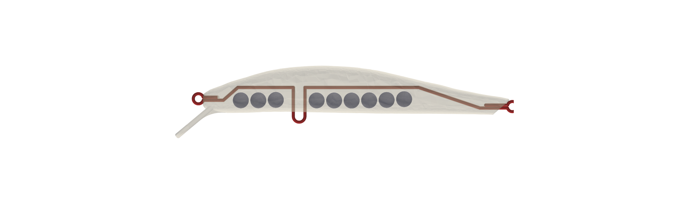

# DMF-Lure – minnow 105 mm imprimé en ABS (FDM)

Corps de leurre relevé sur un **Jackson Artist FR105 Heavy Weight** (105 mm, 32 g), à imprimer
**couché sur le flanc**, surélevé sur supports dédiés, avec **armature inox traversante** et
**billes de lest Ø5 mm** insérées pendant des pauses d'impression. La bavette fait partie du corps
(une seule pièce), avec un grand congé sous le menton.

## Fichiers (`out/`)

| Fichier | Contenu |
|---|---|
| `plateau.3mf` | leurre + supports positionnés, deux objets séparés → **à ouvrir directement dans le slicer** |
| `leurre_impression.stl` | leurre seul, positionné pour l'impression |
| `supports.stl` | supports seuls (même repère) |
| `armature_fil_impression.stl` | fil en place (contrôle visuel, **ne pas imprimer**) |
| `leurre.step`, `armature_fil.step` | CAO (repère leurre) |
| `armature_plan.pdf` | **plan de pliage** : p.1 coté 2:1, p.2 gabarit 1:1 + gamme |
| `rapport.json` | hauteurs de pause, masses, positions des billes, paramètres |

Régénérer : `pip install -r requirements.txt` puis `python3 cad/lure_artist105.py && python3 cad/schema_armature.py`
(≈ 2 min). Tout est paramétrique dans `cad/lure_artist105.py` (`P = dict(...)`), `cad/armature.py` et `cad/geom.py` (profils).

## Géométrie relevée

* Longueur 105 mm, hauteur ≈ 16 mm, épaisseur ≈ 11,2 mm (profils mesurés sur la photo de profil, échelle = 105 mm).
* **Bavette : 40° sous l'axe du corps** (mesuré sur 2 photos : 38–40°), longueur visible 14,8 mm,
  largeur 6 → 11 mm, épaisseur 1,8 mm, bords arrondis R0,6.
* **Congé menton/bavette R ≈ 11,8 mm** (raccord tangent sur 5 mm de chaque côté), qui s'affine vers l'arrière.
* Logements d'yeux 3D Ø5,2 × 0,5 mm.
* Queue coupée en biais comme l'original.

## Impression (ABS)

* Buse 0,4, **couches de 0,2 mm (obligatoire : les pauses sont calées dessus)**.
* **Remplissage 100 %** (ou 6 périmètres + 100 %) : sinon l'ABS enferme de l'air et le leurre est plus léger.
* Supports **du slicer désactivés** (ils sont dans le modèle). Plateau 100–110 °C, enceinte fermée.
* La semelle des supports sert de bordure ; ajouter une bordure dans le slicer est inutile.

### Pauses (insérer un `M600` / « pause à la hauteur »)

| Pause | Z de pause | À faire |
|---|---|---|
| **1** | **9,6 mm** (avant la couche qui commence à 9,6) | poser l'**armature** dans la rainure, bien à plat. Les œillets et l'épingle ventrale dépassent à l'horizontale, dans le vide, au plan médian (Z = 8,8) : ils ne touchent ni le plateau ni les supports. |
| **2** | **11,6 mm** | poser **une bille Ø5 dans chacun des 9 puits** (une goutte de cyano évite qu'elles vibrent). |

Plan médian du leurre à Z = 8,8 mm ; point le plus bas de la pièce à ≈ 3,2 mm du plateau ;
hauteur totale 14,4 mm. À chaque reprise, la buse repasse au-dessus des inserts, qui sont tous
sous le plan de pause, donc sans risque de collision. Le fil a 0,15 mm de jeu radial ; la
rainure fait 1,6 mm d'épaisseur pour coller aux couches de 0,2.

Le slicer peut annoncer quelques triangles dégénérés (issus du maillage) : la réparation automatique suffit.

## Lest, masse et stabilité

Les billes sont placées **sous la tige** (y ≈ -0,2 mm), donc sous le centre de carène (y = +1,95 mm),
pour que le leurre nage le dos en haut. C'est pour ça que la tige de l'armature monte à +4,2 mm
au milieu du corps (voir plus bas). 9 billes Ø5 au maximum avec ≥ 0,8 mm de paroi.

| Billes Ø5 | Masse billes | Masse totale* | CG sous la carène |
|---|---|---|---|
| **Tungstène** | 11,2 g | **≈ 21,9 g** | 1,2 mm |
| Plomb | 6,7 g | ≈ 17,3 g | 1,0 mm |
| Acier | 4,6 g | ≈ 15,3 g | 0,8 mm |

\* ABS plein 9,7 g + fil 1,0 g + billes, **sans hameçons ni anneaux**. Volume extérieur
10,5 cm³ → poussée 10,5 g : le leurre **coule** dans tous les cas.

⚠️ **Les 32 g de l'original ne sont pas atteignables** dans ce volume avec des billes de 5 mm
et un corps ABS plein. Il faudrait ~15 billes de tungstène, mais le ventre est trop étroit pour
loger plus de 9 puits avec une paroi correcte. Avec hameçons et anneaux, on arrive vers 24 g en
tungstène.

## Armature

Fil **inox Ø1,0** (304/316 ressort), longueur développée 162 mm → couper 185 mm.
Plan coté et gabarit 1:1 : `out/armature_plan.pdf`.

Écarts par rapport au croquis fourni :

* Même topologie (œillet de nez avec retour, tige, épingle ventrale en U, tige, œillet de queue avec retour),
  mais la **tige est coudée** : 0 → +4,2 mm (pli 41°) derrière la tête, puis descente de 19° avant la queue.
  Une tige droite passerait au niveau du lest, et il faudrait mettre les billes au-dessus du fil, donc
  au-dessus du centre de carène : le leurre se retournerait.
* Cotes recalculées pour ce corps : **G = 5,0 mm ext.** (épingle sur foret Ø3, entraxe 4,0),
  **H = 12,5 mm** (axe de tige → bas du U, avec 3 mm de jour sous le ventre pour l'anneau brisé),
  œillets Ø int 2,5, retours de 4,9 mm (nez) et 7,5 mm (queue), plus courts que sur le croquis
  pour ne pas empiéter sur les puits de billes.
* Entraxe œillet de nez → épingle ventrale **34,5 mm** (position d'origine 33 mm du nez) ;
  épingle → œillet de queue **73,1 mm**.

## Limites connues

* Profils relevés à la main sur photo (précision ±0,5 mm), et largeur estimée (pas de vue de dessus à plat).
  Pour corriger, modifier les tables `DOS`, `VENTRE`, `DEMI_LARGEUR` dans `cad/geom.py`.
* Nage non testée : l'angle et la taille de la bavette se règlent dans `P` (`bav_angle`, `bav_longueur`, `bav_larg_max`).
