# DMF-Lure – minnow 105 mm en demi-coques ABS

Corps de leurre relevé sur un **Jackson Artist FR105 Heavy Weight** (105 mm), imprimé en
**deux demi-coques** (coupe au plan de symétrie) assemblées au **jus d'ABS**, avec **armature inox Ø1,6
traversante**, **4 billes de tungstène Ø5** et **pions de centrage en tige inox Ø1,6**. La bavette fait corps avec le
leurre, avec un fondu arrondi sous le menton. L'armature se plie sur un **gabarit à pions** (clous Ø2,92).

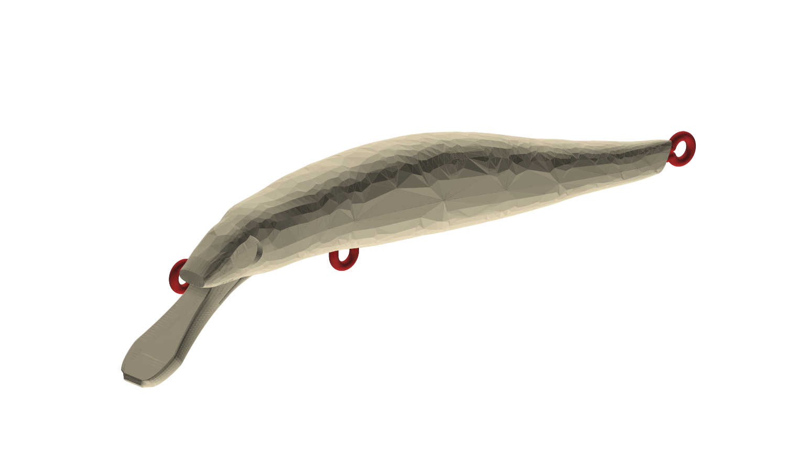
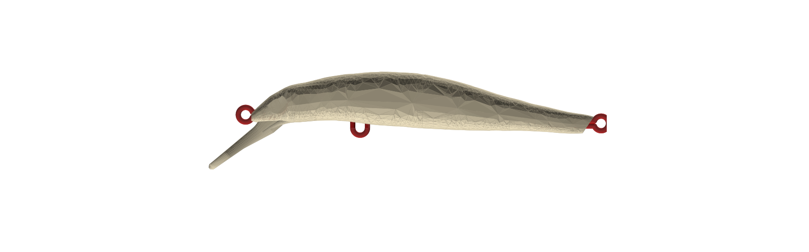
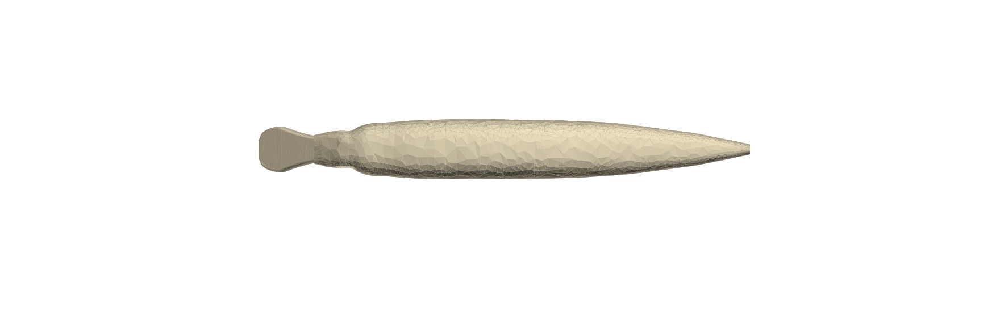
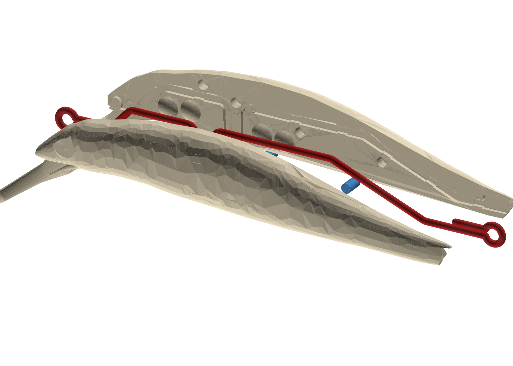

## Fichiers (`out/`)

| Fichier | Contenu |
|---|---|
| `plateau_demi_coques.3mf` | coque A + coque B, déjà posées face plane sur le plateau → **à ouvrir dans le slicer** |
| `demi_coque_A.stl`, `demi_coque_B.stl` | les mêmes, séparées |
| `gabarit_pions_impression.stl`, `gabarit_eprouvette.stl` | gabarit de pliage de l'armature, éprouvette de jeu des trous |
| `armature_plan.pdf` | armature cotée 2:1 (entraxes des pions) + vue 1:1, coordonnées des pions, gamme |
| `leurre.step`, `armature_fil.step`, `gabarit_pions.step` | CAO |
| `rapport.json` | positions des billes / pions / points de serrage, masses, équilibre |

Régénérer : `pip install -r requirements.txt` puis
`python3 cad/demi_coques.py && python3 cad/schema_armature.py && python3 cad/gabarit_pions.py`.
Paramètres : `C` dans `cad/demi_coques.py` (rainure, serrage, pions), `P` dans `cad/lure_artist105.py`
(forme, bavette, billes, hameçons), `Armature` dans `cad/armature.py`, `G` dans `cad/gabarit_pions.py`.

## Impression des demi-coques

* **Face plane contre le plateau, sans aucun support** (la demi-bavette est une paroi verticale).
* ABS, buse 0,4, couches 0,2, **remplissage 100 %** (l'équilibre est calculé pour un corps plein).
* **Compensation de pied d'éléphant à 0 ou très faible** : la rainure et les logements sont sur la face
  plane ; un pied d'éléphant fort ferme les points de serrage.
* Centrage : **4 bouts de tige inox Ø1,6 × 5,4 mm** dans des trous borgnes **Ø1,8 × 3 mm** de chaque côté
  (ajusté glissant une fois imprimé ; si c'est trop serré, passer un foret Ø1,8 à la main, trop lâche : `pion_trou_d`
  dans `C`). Ébavurer les bouts de tige à la lime.

## Ce qui tient l'armature pendant le collage

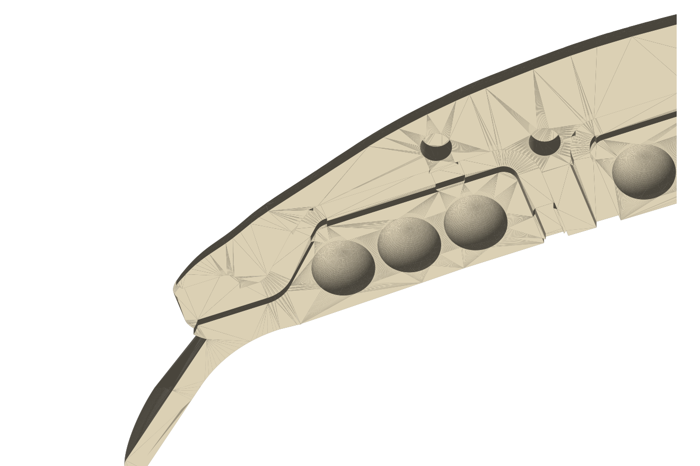

* **Coque A** : rainure de 2,1 mm de large (fil Ø1,6 + 0,5 de jeu), profonde de **0,9 mm**, donc le fil y est
  centré sur le plan de joint. Tous les ~12 mm, un **point de serrage** de 3 mm de long ramène la largeur à
  **1,6 mm** (10 points). On **clipse le fil** dedans en appuyant avec un objet plat : il reste plaqué et à plat.
* **Coque B** : même rainure mais profonde de **1,1 mm**, sans serrage. Elle absorbe un fil un peu gauche et
  le surplus de jus d'ABS.
* Si le serrage est trop dur ou trop mou : `serrage_l` (1,5 à 1,7) dans `C`.

## Assemblage

1. Ébavurer, tester à blanc : fil clipsé dans A, billes, pions, fermer avec B.
2. Une goutte de cyano dans chaque logement de A, poser les **4 billes**.
3. **Clipser l'armature** dans A (l'épingle ventrale et les œillets sortent par les encoches).
4. Enfoncer les **4 bouts de tige inox** dans A (une goutte de cyano au fond).
5. Jus d'ABS (ABS + acétone, consistance crème) au pinceau sur les deux faces planes, en évitant la rainure.
6. Fermer B, serrer (pinces à linge / élastiques), laisser sécher 24 h, poncer le joint.

Le joint au plan médian traverse aussi la bavette, mais dans le sens de sa longueur : les efforts de nage
la font fléchir parallèlement au joint, qui travaille donc peu. La tenue ligne → hameçons est assurée par le fil
traversant, pas par la colle.

## Lest et équilibre

* 4 logements sphériques **sous la tige**, moitié dans chaque coque, billes collées :
  rien ne bouge en nage, rien ne fait gîter le leurre.
* **Roulis** : CG **1,6 mm sous le centre de carène** (hameçons montés).
* **Tangage** : le nombre de billes est choisi pour une assiette au repos proche de l'horizontale.

| | |
|---|---|
| Volume extérieur | 14,0 cm³ (poussée 14,0 g) |
| ABS (plein) | 13,6 g |
| Fil inox Ø1,6 | 2,7 g |
| 4 billes tungstène Ø5 | 5,0 g |
| **Total avec 2 hameçons (0,9 g)** | **≈ 23,1 g**, assiette au repos ≈ **+6,6°** (léger nez en bas) |

Le corps aux vraies cotes est nettement plus volumineux que la première version (14,5 mm de large au lieu de 11) :
il y a plus d'ABS, et l'équilibre en tangage ne tolère que 4 billes sur les 8 logements possibles.

Autre matériau ou autres hameçons : `bille_mat` / `hamecon_g` dans `P`, relancer.

## Armature (fil inox Ø1,6, recuit) et gabarit

Longueur développée 168 mm → **couper 190 mm**. Tous les plis se font autour des clous du gabarit
(rayon de fibre neutre 2,26 mm) : gabarit, plan et rainures ont exactement la même forme.

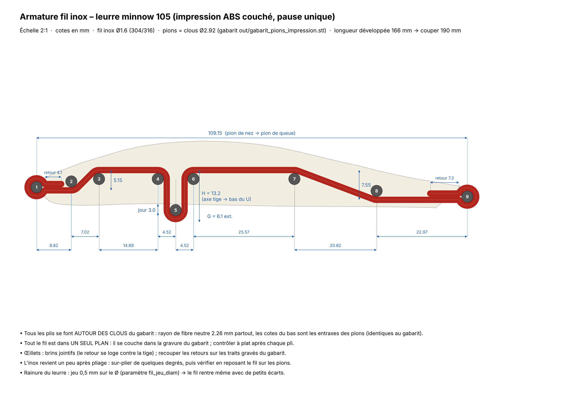
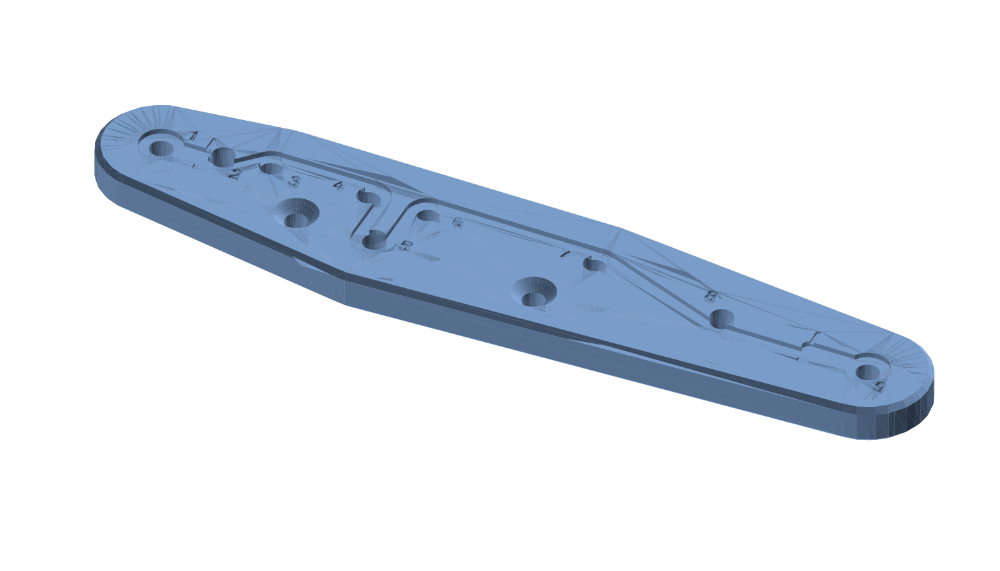
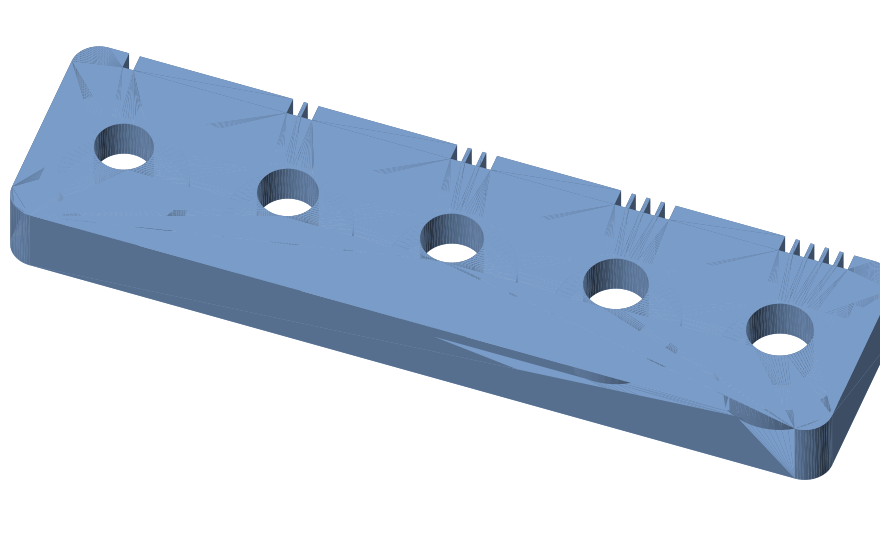

* **Plaque pleine de 6 mm** (enveloppe du tracé + 7 mm de marge, arêtes chanfreinées), ≈ 15 cm³ / 17 g,
  128 × 26 mm. Plus de zones fines.
* **9 trous Ø3,4** pour clous Ø2,92 (≈ 0,5 mm de jeu, le FDM resserre les trous d'environ 0,2 mm), avec un
  **lamage Ø6,8 × 1,6 par dessous** pour la tête Ø6 : le clou se glisse par dessous et le gabarit reste à plat.
* 2 trous de vis Ø3 fraisés pour le visser sur une planchette, placés loin du fil et des bords.
* Tracé du fil gravé (0,8 mm), numéros des pions gravés, traits de coupe des retours.
* Impression : **dessus gravé vers le haut**, lamages contre le plateau, sans support. 4 périmètres, 40 % de remplissage.
* **Éprouvette** `gabarit_eprouvette.stl` (≈ 2 g) : trous Ø3,1 / 3,2 / 3,3 / 3,4 / 3,5 (1 à 5 encoches).
  Imprime-la d'abord, garde le trou où le clou glisse sans jeu, et mets cette valeur dans `trou_d` (`G`).
* Prendre de l'inox **recuit** (304/316 doux) : de l'inox « ressort » risque de casser au rayon d'un clou de 2,92.

## Géométrie relevée

* Profils extraits des silhouettes de tes photos (vue de profil + vue de dessus), puis calés sur tes cotes :

| x depuis le nez | Hauteur | Largeur |
|---|---|---|
| ≈ 15 mm (tête) | 11,9 mm | 13,2 mm |
| ≈ 45–50 mm (maxi) | 16,9 mm | 14,5 mm |
| ≈ 90–95 mm (queue) | 8 mm | 6 mm |
| longueur | 105 mm | |

  Dos bombé, ventre presque droit qui remonte vers la tête, tête resserrée aux ouïes (`cad/geom.py`).

### Bavette

| | |
|---|---|
| Angle | 40° sous l'axe du corps |
| Longueur visible | **16 mm** du menton au bout (mesuré), pointe ≈ 9 mm devant le nez |
| Forme en plan | col 7 mm au menton → **9 mm** au 1er quart → **13 mm** maxi à 12 mm → bout arrondi (mesuré) |
| Épaisseur | **4 mm à la racine → 2 mm au bout** (face avant plane, la face arrière converge) |
| Nervure | **en V sous la bavette**, 1,2 mm de saillie à la racine, 4,4 mm de large, s'efface à 7,6 mm |
| Dessus | plat, **relevé de 1 mm sur les 4 derniers mm** avant le menton |
| Bords | chants latéraux R0,6, bord d'attaque arrondi |
| Fondu menton | loft de sections arrondies sous la bavette, rayon ≈ 16 mm |

Tout se règle dans `P` (`bav_*`) de `cad/lure_artist105.py`.

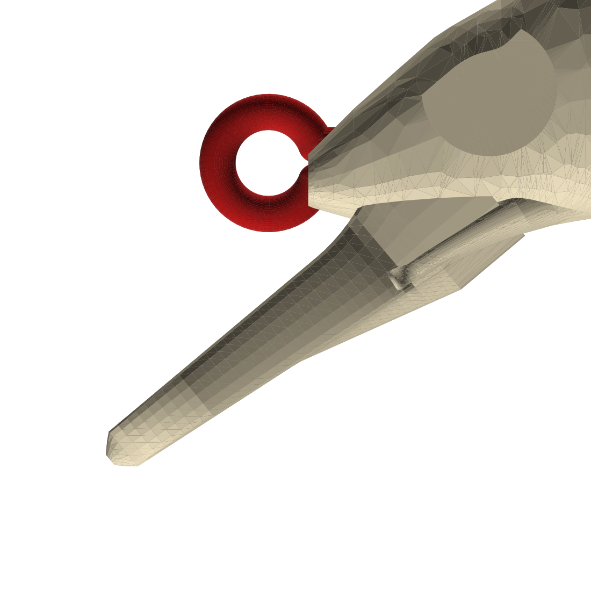
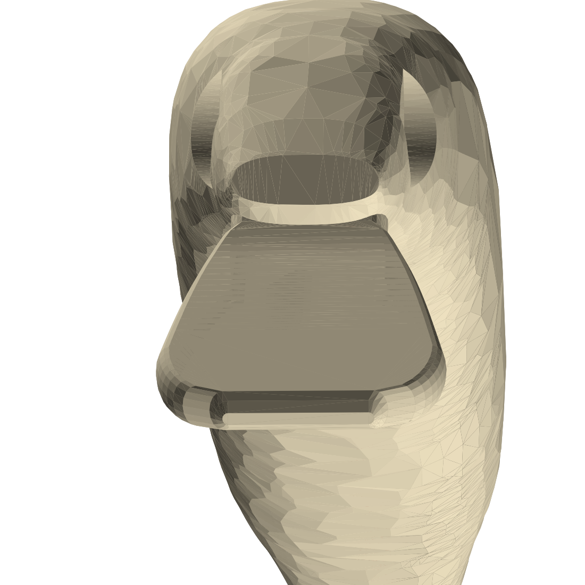
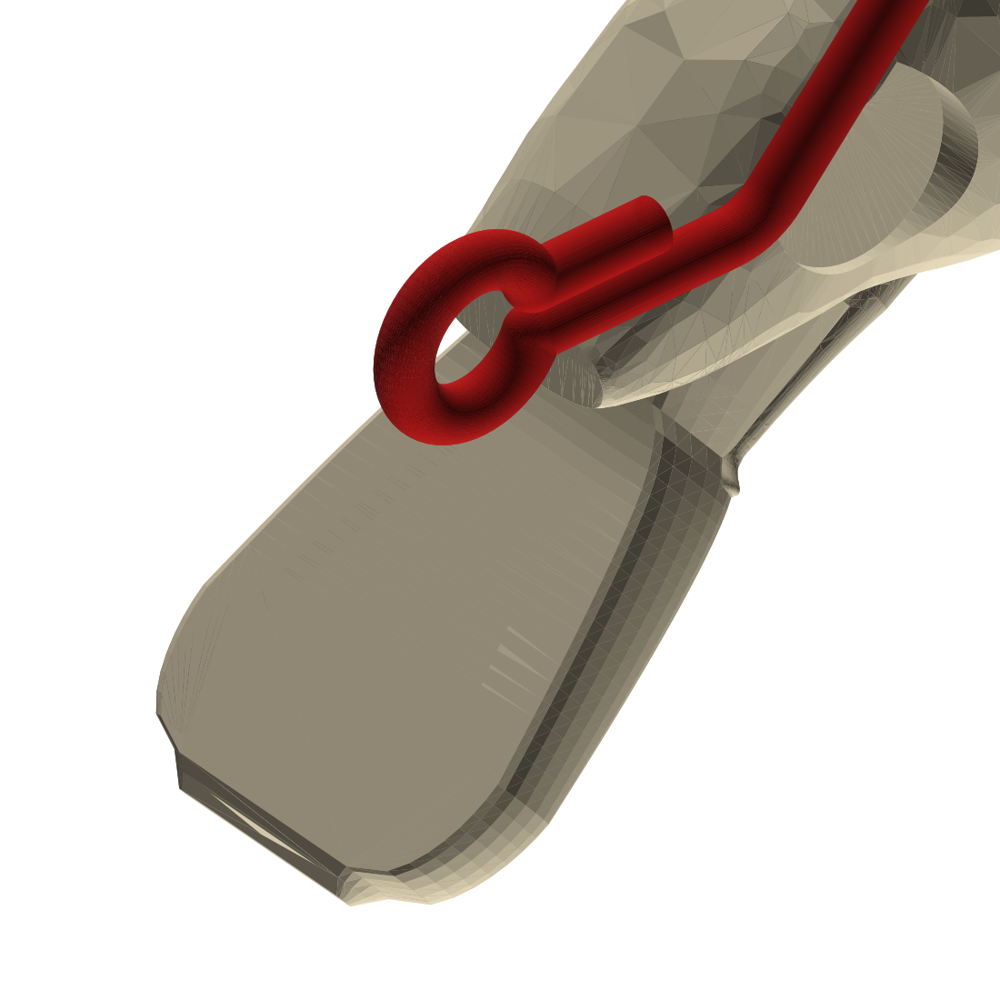
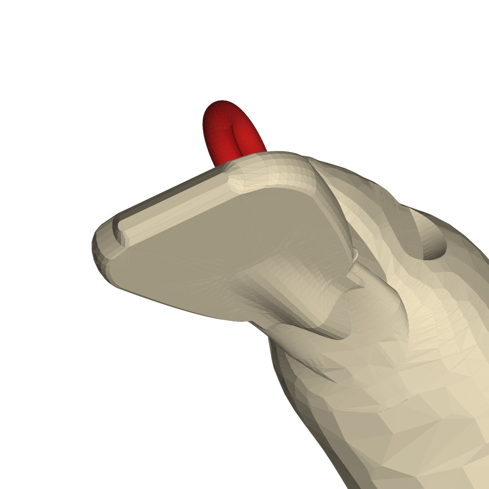

## Limites connues

* Profils relevés à la main (±0,5 mm), largeur estimée.
* Nage non testée : bavette réglable dans `P` (`bav_angle`, `bav_longueur`, `bav_larg_max`).
* L'ancienne version monobloc (impression couchée avec pause) reste dans `cad/lure_artist105.py`
  (`python3 cad/lure_artist105.py`) mais n'est plus la version recommandée.
