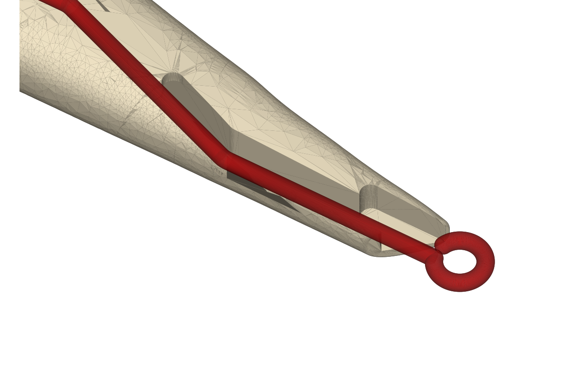
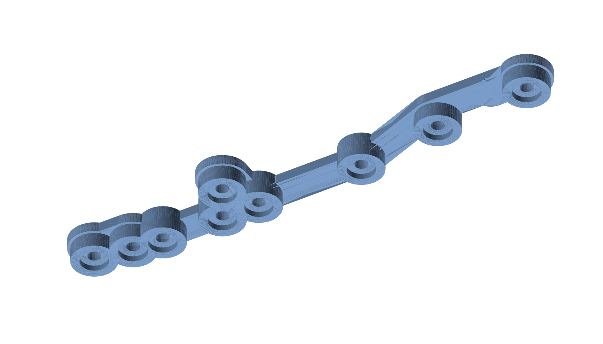

# DMF-Lure – minnow 105 mm imprimé en ABS (FDM)

Corps de leurre relevé sur un **Jackson Artist FR105 Heavy Weight** (105 mm), à imprimer
**couché sur le flanc**, surélevé sur supports dédiés, avec **armature inox Ø1,6 traversante** et
**7 billes de lest Ø5 mm**. Armature et billes se posent pendant **une seule pause**.
La bavette fait corps avec le leurre, avec un fondu arrondi sous le menton.
L'armature se plie sur un **gabarit à pions imprimé** (clous Ø2,92).

## Fichiers (`out/`)

| Fichier | Contenu |
|---|---|
| `plateau.3mf` | leurre + supports positionnés (2 objets) → **à ouvrir directement dans le slicer** |
| `leurre_impression.stl`, `supports.stl` | les mêmes, séparés |
| `gabarit_pions_impression.stl` | **gabarit de pliage**, déjà retourné pour l'impression |
| `armature_plan.pdf` | p.1 : armature cotée 2:1 (entraxes des pions) ; p.2 : vue 1:1, coordonnées des pions, gamme |
| `armature_fil_impression.stl` | fil en place (contrôle visuel, **ne pas imprimer**) |
| `leurre.step`, `armature_fil.step`, `gabarit_pions.step` | CAO |
| `rapport.json` | hauteur de pause, gardes, masses, positions des billes, paramètres |

Régénérer : `pip install -r requirements.txt`, puis
`python3 cad/lure_artist105.py && python3 cad/schema_armature.py && python3 cad/gabarit_pions.py`.
Tout est paramétrique : `P` dans `cad/lure_artist105.py`, `Armature` dans `cad/armature.py`,
`G` dans `cad/gabarit_pions.py`, profils du corps dans `cad/geom.py`.

## Impression du leurre (ABS)

* Buse 0,4, **couches de 0,2 mm** (la pause est calée dessus), **remplissage 100 %**.
* Supports du slicer **désactivés** (ils sont dans le modèle). Plateau 100–110 °C, enceinte fermée.

### Une seule pause : **Z = 11,6 mm**

La rainure du fil et les 7 puits de billes sont **tous ouverts jusqu'au même plan** (Z = 11,6).
À la pause, rien de ce que tu poses ne dépasse ce plan :

| Insert posé au fond de son logement | Haut de l'insert | Buse à la reprise | Garde |
|---|---|---|---|
| Billes Ø5 (puits Ø5,4) | 11,1 | 11,8 | **0,7 mm** |
| Fil Ø1,6 (rainure 2,1 mm de large, fond à −1,0) | 9,4 | 11,8 | **2,4 mm** |
| Œillets et épingle (dans le vide, hors du corps) | ≈ 9,4 | 11,8 | **2,4 mm** |

La 1re couche après la pause fait un pont au-dessus des puits (Ø5,4) et de la rainure (2,1 mm).
Une bille ne peut pas sortir de son puits par le haut, donc la buse ne peut pas la toucher.

**À la pause :**
1. Poser l'armature au fond de sa rainure (jeu 0,5 mm sur le Ø → elle tombe sans forcer).
2. Une petite goutte de **cyano gel** tous les ~15 mm sur le fil, contre le fond : la rainure est ouverte
   au-dessus du fil jusqu'au plan de pause, il faut donc coller le fil pour qu'il ne flotte pas.
3. Une goutte de cyano au fond de chaque puits, puis **une bille par puits**.
4. Vérifier que rien ne dépasse (règle posée à plat), relancer.

**Zones laissées ouvertes (normal) :** la queue, à partir de x ≈ 77 mm, est plus fine que le plan de
pause. La rainure ne peut pas y être refermée, elle débouche donc franchement sur le flanc du dessus.
Même chose à la sortie du nez et aux deux pieds de l'épingle ventrale (≈ 1 mm).
**Après l'impression**, garnir ces rainures à la pâte époxy ou au jus d'ABS (ABS + acétone, *pas pendant
l'impression*), puis poncer. La tenue mécanique vient du fil traversant (ligne → hameçons), pas du plastique.

## Lest et équilibre

* Billes **figées** (collées, une par puits) dans le plan de symétrie : rien ne bouge en nage,
  rien ne fait gîter le leurre.
* **Roulis** : billes sous la tige, CG **2,0 mm sous le centre de carène** (hameçons montés).
* **Tangage** : l'hameçon de queue fait piquer l'arrière. Les puits et la position de l'épingle
  sont choisis pour une assiette au repos quasi horizontale :

| Billes Ø5 (7) | Masse billes | Total avec 2 hameçons (0,9 g) | Assiette au repos |
|---|---|---|---|
| **Tungstène** (prévu) | 8,7 g | **≈ 22,2 g** | **−3° (quasi à plat)** |
| Plomb | 5,2 g | 18,7 g | −38° (queue en bas) |
| Acier | 3,6 g | 17,1 g | −51° (queue en bas) |

Avec d'autres billes ou d'autres hameçons, changer `bille_mat` / `hamecon_g` dans `P` et relancer :
le nombre de puits se recalcule. Les 32 g de l'original ne sont pas atteignables dans ce volume (10,5 cm³)
avec des billes de 5 mm.

## Armature (fil inox Ø1,6)

Longueur développée 166 mm → **couper 190 mm**. Tous les plis se font **autour des clous** du gabarit
(rayon de fibre neutre 2,26 mm), donc le gabarit, le plan et la rainure du leurre ont exactement la même forme.

* Œillets nez/queue : un tour autour des pions 1 et 9, brins jointifs, retours recoupés aux traits gravés.
* Épingle ventrale : autour des pions 4-5-6, **G = 6,1 mm ext.**, **H = 13,2 mm** (axe tige → bas du U),
  3 mm de jour sous le ventre pour l'anneau brisé. Axe à 33,5 mm du nez (original : ≈ 33).
* Tige coudée (pions 2-3 : 45°, pions 7-8 : 21°) pour passer au-dessus du lest.

## Gabarit de pliage à pions

* 9 trous Ø3,0 pour clous Ø2,92 (serrage léger en FDM), **lamage Ø6,4 × 1,4 mm par dessous** pour la tête Ø6 :
  le clou se glisse par dessous, sa tête reste noyée et le gabarit repose à plat sur ses bossages.
* Matière minimale : semelle de 2,4 mm qui suit le fil (ruban de 7,2 mm) + bossages Ø10,4 × 6 mm sous les pions
  (4,6 mm de clou tenu). **≈ 4,6 cm³ (≈ 5 g)**, 121 × 20 × 6 mm.
* Tracé du fil gravé sur le dessus (0,6 mm) : le fil s'y couche et reste plan. Traits de coupe au bout des retours.
* Impression : fichier déjà retourné (dessus contre le plateau), sans support, PLA/PETG/ABS, 4 périmètres.
* Si la tête de tes clous est plus épaisse que 1,2 mm : `tete_h` dans `G`. Si le serrage est trop dur ou trop
  lâche : `trou_d`.

Mode opératoire détaillé et coordonnées des pions : page 2 de `out/armature_plan.pdf`.
L'inox revient un peu après pliage : sur-plier légèrement, puis reposer le fil sur les pions pour contrôler.

## Géométrie relevée

* Longueur 105 mm, hauteur ≈ 16 mm, épaisseur ≈ 11,2 mm (profils mesurés sur photo).
* Bavette à 40° sous l'axe, longueur visible 14,8 mm, largeur 6 → 11 mm, épaisseur 1,8 mm, bords R0,8.
* Fondu menton/bavette : loft de sections arrondies, rayon de raccord ≈ 12 mm, sans arête vive.

## Limites connues

* Profils relevés à la main sur photo (±0,5 mm) et largeur estimée : tables de `cad/geom.py`.
* Nage non testée : bavette réglable dans `P` (`bav_angle`, `bav_longueur`, `bav_larg_max`).
* Le slicer peut signaler quelques triangles dégénérés (maillage) : la réparation automatique suffit.
