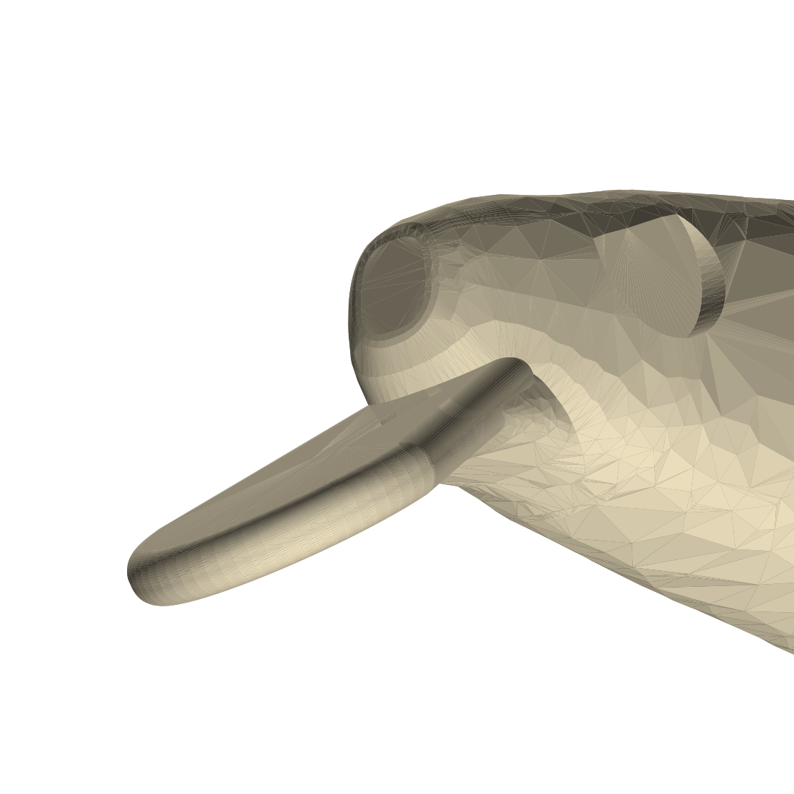

# DMF-Lure – minnow 105 mm imprimé en ABS (FDM)

Corps de leurre relevé sur un **Jackson Artist FR105 Heavy Weight** (105 mm, 32 g), à imprimer
**couché sur le flanc**, surélevé sur supports dédiés, avec **armature inox Ø1,6 traversante** et
**billes de lest Ø5 mm** insérées pendant des pauses d'impression. La bavette fait partie du corps
(une seule pièce), avec un grand congé sous le menton.

## Fichiers (`out/`)

| Fichier | Contenu |
|---|---|
| `plateau.3mf` | leurre + supports positionnés, deux objets séparés → **à ouvrir directement dans le slicer** |
| `leurre_impression.stl` | leurre seul, positionné pour l'impression |
| `supports.stl` | supports seuls (même repère) |
| `armature_fil_impression.stl` | fil en place (contrôle visuel, **ne pas imprimer**) |
| `leurre.step`, `armature_fil.step` | CAO (repère leurre) |
| `armature_plan.pdf` | **plan de pliage** : p.1 coté 2:1, p.2 gabarit 1:1 + gamme |
| `rapport.json` | hauteurs de pause, masses, positions des billes, paramètres |

Régénérer : `pip install -r requirements.txt` puis `python3 cad/lure_artist105.py && python3 cad/schema_armature.py`
(≈ 2 min). Tout est paramétrique dans `cad/lure_artist105.py` (`P = dict(...)`), `cad/armature.py` et `cad/geom.py` (profils).

## Géométrie relevée

* Longueur 105 mm, hauteur ≈ 16 mm, épaisseur ≈ 11,2 mm (profils mesurés sur la photo de profil, échelle = 105 mm).
* **Bavette : 40° sous l'axe du corps** (mesuré sur 2 photos : 38–40°), longueur visible 14,8 mm,
  largeur 6 → 11 mm, épaisseur 1,8 mm, tous les bords arrondis R0,8.
* **Fondu menton/bavette** : loft de sections arrondies entre la face arrière de la bavette et le ventre,
  rayon de raccord ≈ 12 mm, raccord tangent sur 5 mm de chaque côté, pas d'arête vive.
  Il s'affine de la largeur de la bavette jusqu'à 5 mm sous le ventre.
* Logements d'yeux 3D Ø5,2 × 0,5 mm. Queue coupée en biais comme l'original.

## Impression (ABS)

* Buse 0,4, **couches de 0,2 mm (obligatoire : les pauses sont calées dessus)**.
* **Remplissage 100 %** : sinon l'ABS enferme de l'air et l'équilibre calculé ne tient plus.
* Supports **du slicer désactivés** (ils sont dans le modèle, avec un mur plein sous la bavette).
  Plateau 100–110 °C, enceinte fermée. Activer le **Z-hop (0,4 mm)** sur les déplacements.

### Pauses

| Pause | Z | À faire |
|---|---|---|
| **1** | **9,8 mm** (avant la couche qui commence à 9,8) | poser l'**armature Ø1,6** dans la rainure, **bien à plat** |
| **2** | **11,6 mm** | une goutte de cyano au fond de chaque puits, puis **une bille Ø5 dans chacun des 7 puits** |

Garde entre la buse et les inserts, au moment de la reprise (plan médian à Z = 8,8) :

| Insert | Haut de l'insert posé | Z de pause | Buse sur la 1re couche après pause | Garde |
|---|---|---|---|---|
| Fil Ø1,6 (rainure ±1,0) | 8,8 + 0,6 = 9,4 | 9,8 | 10,0 | **0,6 mm** |
| Bille Ø5 (puits Ø5,4, fond à −2,7) | 8,8 + 2,3 = 11,1 | 11,6 | 11,8 | **0,7 mm** |

Même une bille soulevée ne peut pas dépasser le haut du puits (11,6), et la buse reprend à 11,8 au
minimum. Le seul vrai risque, c'est un **fil qui n'est pas plan** : les œillets et l'épingle
dépassent à l'horizontale dans le vide à Z ≈ 8,8 et doivent rester sous 9,8. Vérifie-le à la
règle avant de relancer.

La 1re couche après chaque pause fait un pont au-dessus de la rainure (1,9 mm) et des puits (5,4 mm).

## Lest, équilibre (roulis et tangage)

* Les billes sont **figées** (une bille par puits, collée) : elles ne roulent pas et ne déplacent pas le
  centre de gravité pendant la nage. Elles sont rangées dans le plan de symétrie, donc rien ne fait
  gîter le leurre latéralement.
* **Roulis** : billes sous la tige (y ≈ −0,3), sous le centre de carène (y = +1,96). Avec les hameçons,
  le CG est **2,0 mm sous la carène** : le leurre se remet dos en haut.
* **Tangage** : au repos, le leurre s'incline jusqu'à mettre le CG à la verticale du centre de carène.
  L'hameçon de queue (≈ 67 mm derrière la carène) fait piquer la queue ; avec 9 billes, on aurait
  ≈ 23° **queue en bas**. Le script retire donc les puits arrière jusqu'à une assiette
  légèrement nez en bas : **7 puits** (x = 13,75 → 57,75 mm), assiette ≈ **+1,5° nez en bas**.

| Billes Ø5 (7) | Masse billes | Total sans hameçons | Total avec 2 hameçons | Assiette au repos (hameçons) |
|---|---|---|---|---|
| **Tungstène** (prévu) | 8,7 g | 21,0 g | **≈ 22,8 g** | **+1,5°** |
| Plomb | 5,2 g | 17,5 g | 19,3 g | −37° (queue en bas) |
| Acier | 3,6 g | 15,9 g | 17,7 g | −51° (queue en bas) |

L'équilibre est calé pour **du tungstène et des hameçons de 0,9 g chacun (triple + anneau)**. Avec un autre
matériau ou d'autres hameçons, changer `bille_mat` / `hamecon_g` dans `P` et relancer :
le nombre de puits se recalcule. L'écart CG/carène reste petit (2 mm), donc l'assiette est sensible :
0,1 mm de décalage du CG en longueur, c'est environ 3°. Pour la nage elle-même, c'est la traction de
la ligne et la bavette qui commandent ; l'assiette joue surtout sur la coulée et les pauses.

⚠️ **Les 32 g de l'original ne sont pas atteignables** dans ce volume (10,5 cm³) avec des billes de 5 mm :
le ventre est trop étroit pour plus de puits avec une paroi correcte (≥ 0,8 mm).

## Armature

Fil **inox Ø1,6**, longueur développée 169 mm → couper 190 mm. Œillets et épingle sur **foret Ø3**.
Plan coté et gabarit 1:1 : `out/armature_plan.pdf`.

* Même topologie que le croquis (œillet de nez avec retour, tige, épingle ventrale en U, tige, œillet de
  queue avec retour), mais la **tige est coudée** : montée de 45° derrière la tête jusqu'à +4,2 mm, puis
  descente de 19° avant la queue. Elle passe ainsi au-dessus du lest, qui reste bas.
* Cotes pour ce corps : **G = 6,2 mm ext.**, **H = 13,1 mm** (axe de tige → bas du U, 3 mm de jour sous
  le ventre pour l'anneau brisé), entraxe nez → épingle **34,8 mm**, épingle → queue **74,4 mm**,
  retours 4,6 mm (nez) et 8,3 mm (queue).

## Limites connues

* Profils relevés à la main sur photo (±0,5 mm), largeur estimée (pas de vue de dessus à plat) :
  tables `DOS`, `VENTRE`, `DEMI_LARGEUR` dans `cad/geom.py`.
* Nage non testée : la bavette se règle dans `P` (`bav_angle`, `bav_longueur`, `bav_larg_max`).
* Le slicer peut signaler quelques triangles dégénérés (maillage) : la réparation automatique suffit.
