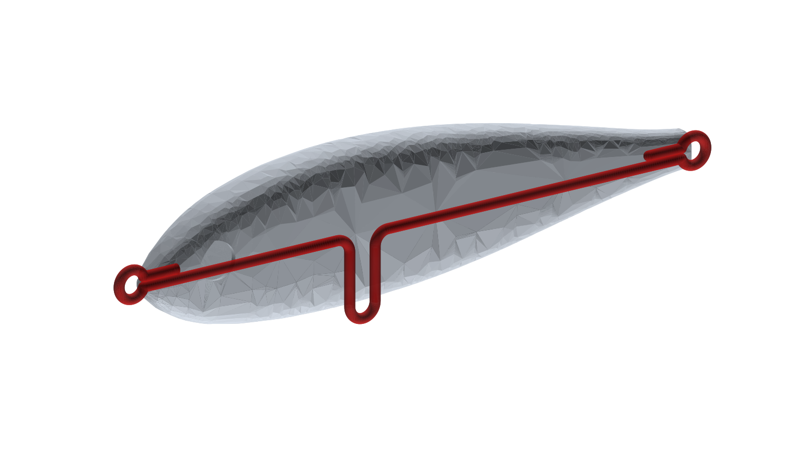
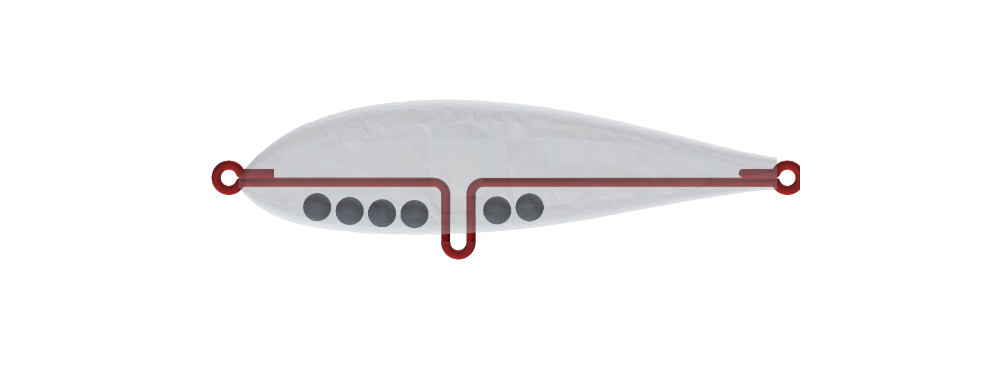
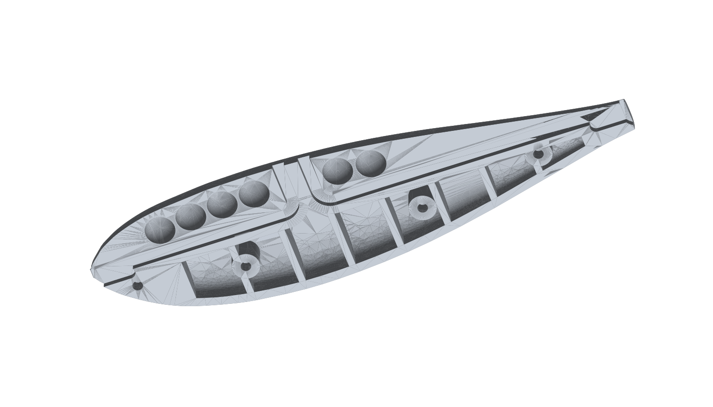

# Stickbait 95 mm coulant – demi-coques ABS

Conception originale de stickbait « scad » (catégorie 95 mm / ~22 g, coulant lent) pour impression FDM,
avec la même méthode d'assemblage que le minnow : 2 demi-coques collées au jus d'ABS, armature inox Ø1,6,
billes de tungstène Ø5, pions de centrage en tige inox Ø1,6. Script : `cad/stickbait95.py`.

## Fichiers

| Fichier | Contenu |
|---|---|
| `stickbait95_plateau.3mf` | coques A et B posées face plane, prêtes pour le slicer |
| `stickbait95_coque_A.stl`, `stickbait95_coque_B.stl` | les mêmes, séparées |
| `stickbait95_gabarit_impression.stl` | gabarit de pliage à clous Ø2,92 (même conception que celui du minnow) |
| `stickbait95_armature.step` | fil en 3D |
| `rapport.json` | billes, pions, points de serrage, masses, équilibre |

## Dimensions

95 mm de long, 24 mm de haut (maxi vers 35 % de la longueur), 12,7 mm d'épaisseur, flancs plats,
carène ventrale, queue tronquée de 5,7 mm, nez arrondi. Logements d'yeux 3D Ø6 × 0,5.

## Ce qui le fait nager

* **Centre de gravité très bas** : 6 billes de tungstène dans la carène, corps allégé par des alvéoles
  fermées (peau ≥ 1,5 mm). Le CG est **4,4 mm sous le centre de carène** : le leurre se remet dos en haut
  immédiatement et roule en descente (« flash »).
* **Équilibre en longueur** : CG à l'aplomb du centre de carène (x ≈ 40 mm) → il **coule à plat**
  (assiette +0,8° avec les hameçons) et part en S à la tirée, au lieu de piquer du nez.
* **Traction au nez, sur l'axe bas** : œillet de nez à y = +0,2, sous le milieu du nez.
* **Densité ≈ 1,5** (23,9 g pour 16 cm³) : coulée régulière, lancer long.

| | |
|---|---|
| ABS (corps imprimé plein, hors alvéoles) | 12,0 g |
| Fil inox Ø1,6 (155 mm) | 2,5 g |
| 6 billes tungstène Ø5 | 7,5 g |
| **Total sans hameçons** | **≈ 21,9 g** |
| Avec 2 hameçons (≈ 1 g chacun) | ≈ 23,9 g |

Avec du plomb à la place du tungstène, l'équilibre change complètement (le script recalcule : `bille_mat`).

## Impression

* ABS, buse 0,4, couches 0,2, **remplissage 100 %** dans les zones pleines, 4 périmètres.
* Coques **face plane au plateau, sans support**. Les alvéoles sont des poches ouvertes vers le plateau ;
  les cloisons tous les 9 mm limitent les ponts au plafond.
* Pied d'éléphant à 0 (rainure du fil et points de serrage sur la face plane).

## Armature (fil inox Ø1,6 recuit) – couper 175 mm

Pions (centres des clous), repère : x depuis le nez, y vers le dos :

| N° | Pion | x | y | pli |
|---|---|---|---|---|
| 1 | œillet de nez | −3,06 | 0,20 | tour complet |
| 2 | épingle gauche | 33,48 | −2,86 | 90° |
| 3 | épingle ventrale | 38,00 | −11,34 | 180° |
| 4 | épingle droite | 42,52 | −2,86 | 90° |
| 5 | œillet de queue | 96,86 | 0,20 | tour complet |

Tige droite de l'œillet de nez à l'œillet de queue, épingle ventrale à 38 mm du nez (3 mm de jour sous le ventre),
retours de 5 mm (nez) et 6 mm (queue), brins jointifs.

## Assemblage

1. Test à blanc : fil clipsé dans A, billes, pions inox (4 × Ø1,6 × 4,6 mm), fermer avec B.
2. Cyano au fond des 6 logements de A, poser les billes.
3. Clipser l'armature dans A.
4. Pions inox dans A (goutte de cyano).
5. Jus d'ABS sur les deux faces planes (bords, cloisons, carène), en évitant la rainure, fermer, serrer 24 h.
6. Poncer le joint, peindre, vernir (époxy ou vernis 2K : les alvéoles internes doivent rester étanches).
